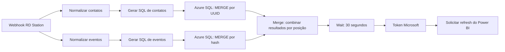

# RD Station → Azure SQL → Power BI

Case de engenharia e automação com **n8n, webhook RD Station, JavaScript, Azure SQL e API Microsoft Power BI**. Contatos e conversões percorrem dois ramos de tratamento e persistência antes da solicitação de atualização do painel.

Projeto complementar: [painel de leads e conversões com cards HTML dinâmicos](https://github.com/alosiolemos/powerbi-rdstation-leads-conversions).

## O desafio

Consolidar contatos e conversões, reduzir reprocessamentos duplicados e manter o relatório disponível para análise sem repetir a preparação manual a cada consulta. Segundo o autor, o processo anterior exigia quase um dia de trabalho e passou a ser consultado em poucos segundos. Esse ganho é um relato operacional; não foi medido nesta preparação.

## Como o fluxo trabalha

O **Merge do n8n** reúne as saídas dos dois ramos. O **MERGE SQL** identifica registros existentes para atualizar ou inserir. São responsabilidades diferentes, ambas importantes na solução.

## Destaques técnicos

- Tratamento de campos opcionais, datas, arrays e objetos do webhook.
- Contatos consolidados por UUID, com ROW_NUMBER para reduzir repetição dentro do lote.
- Conversões identificadas por chave composta e hash SHA2_256.
- Persistência em lote por OPENJSON e MERGE no Azure SQL.
- Sincronização dos resultados antes da etapa de atualização analítica.
- Autenticação Microsoft via client credentials e refresh pela API do Power BI.

## Screenshots

## Template e código

- [Workflow JSON preparado](workflows/rdstation-azure-powerbi.template.json): **inativo**, sem credenciais e sem dados fixados.
- Quatro nós de integração desabilitados: dois SQL, token e refresh.
- [Quatro códigos JavaScript](code) e [payload fictício](examples/webhook-demo.json).
- [Configuração e teste](docs/configuracao.md).

O JSON é um template para configurar em ambiente de teste. Não inclui banco, tabelas, índices, app Microsoft ou conexões ativas. A importação no n8n não foi executada nesta preparação.

## Documentação

- [Arquitetura e fluxo](docs/arquitetura.md)
- [Tratamento de contatos e eventos](docs/tratamento.md)
- [Chaves, duplicidade e MERGE SQL](docs/persistencia.md)
- [Merge do n8n e sincronização](docs/sincronizacao.md)
- [Autenticação e refresh do Power BI](docs/powerbi-refresh.md)
- [Inventário dos 16 nós](docs/inventario.md)
- [Preparação pública](docs/publicacao.md)
- [Validação e limites](docs/validacao.md)

## Limites de interpretação

O webhook contém a última conversão de cada lead recebido. O fluxo acumula esses eventos, mas não comprova recuperação de todo o histórico anterior. A chamada de refresh é assíncrona; não equivale a confirmar a conclusão nem garante atualização de uma página já aberta. A automação continua sujeita a autenticação, disponibilidade e limites dos serviços.
